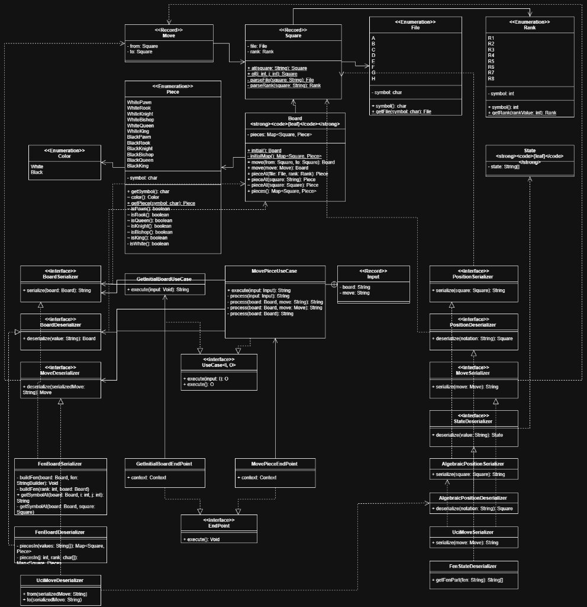

# 📐 Diagramas de Clases y Arquitectura Hexagonal — Chess Software

Este directorio contiene los diagramas de clases UML correspondientes al sistema de **Ajedrez (Chess Software)**, modelados siguiendo los principios de la **Arquitectura Hexagonal (Puertos y Adaptadores)**, Inversión de Dependencias (**Pure DI**), **Domain-Driven Design (DDD)** y principios **SOLID**.

---

## 1. Módulo `backend/game` (Núcleo de Ajedrez, Casos de Uso y Adaptadores)

Diagrama de clases integral del módulo del backend encargado del modelado puro del ajedrez, orquestación mediante casos de uso, abstracción de puertos de entrada/salida y adaptadores técnicos (HTTP Javalin, FEN, UCI y Algebraico).

### Puntos Clave de Diseño:

### A. Core de Dominio Inmutable (`architecture.domain.model`)
- **Entidades y Modelos:**
  - `Board`: Representa el estado del tablero mediante una estructura inmutable `Map<Square, Piece>`. Provee métodos factoría (`initial()`, `initialMap()`) y transiciones de estado inmutables (`move(Move): Board`).
  - `Square` (Record): Coordenada bidimensional inmutable formada por columna `File` y fila `Rank`.
  - `Move` (Record): Desplazamiento compuesto por casilla origen `from` y destino `to`.
  - `Piece` (Enum): Catálogo completo de las 12 piezas (blancas y negras) con métodos de inspección (`getSymbol()`, `color()`, `isPawn()`, etc.).
  - `Color`, `File`, `Rank` (Enums): Tipado fuerte para bandos y geometría del tablero de 8x8.
  - `State`: Encapsula el estado global de la partida (turnos, derechos de enroque, peón al paso, contadores).

### B. Casos de Uso y Orquestación (`architecture.usecases`)
- **Contrato genérico:** `UseCase<I, O>` desacopla la firma de ejecución (`execute(input): O`).
- **`GetInitialBoardUseCase`:** Obtiene el tablero inicial del dominio (`Board.initial()`) y delega su transformación en el puerto `BoardSerializer`.
- **`MovePieceUseCase`:** Recibe el record inmutable `Input(board: String, move: String)`, ejecuta la cadena de transformación limpia (`process`), deserializa FEN y movimiento UCI, aplica el movimiento en el dominio (`board.move(move)`) y serializa el resultado final.

### C. Puertos Segregados (ISP Extremo — `architecture.ports`)
- **Puertos de Entrada (`ports.in`):**
  - `BoardDeserializer`: Lectura y parsing de cadenas de tablero (ej. FEN).
  - `MoveDeserializer`: Lectura y parsing de movimientos serializados (ej. UCI `"e2e4"`).
  - `PositionDeserializer`: Conversión de cadenas de posición (ej. `"e4"`) a `Square`.
  - `StateDeserializer`: Deserialización del estado completo de la partida.
- **Puertos de Salida (`ports.out`):**
  - `BoardSerializer`: Serialización del tablero a formato textual/almacenable.
  - `MoveSerializer`: Serialización de objetos `Move` a formato textual.
  - `PositionSerializer`: Serialización de coordenadas `Square` a texto.

### D. Adaptadores de Infraestructura (`infrastructure.adapters`)
- **Adaptadores de Entrada (`adapters.in`):**
  - Web Javalin: `GetInitialBoardEndPoint` y `MovePieceEndPoint` (implementando `EndPoint`), actuando como traductores bilingües entre peticiones HTTP y los casos de uso.
  - Formatos: `FenBoardDeserializer`, `FenStateDeserializer`, `UciMoveDeserializer` y `AlgebraicPositionDeserializer`.
- **Adaptadores de Salida (`adapters.out`):**
  - Formatos: `FenBoardSerializer`, `UciMoveSerializer` y `AlgebraicPositionSerializer`.

### E. Inversión de Dependencias (Pure DI)
- Ninguna clase de negocio o adaptador crea instancias acopladas de sus colaboradores.
- En `Main.java` (*Composition Root*), se crean los adaptadores y se inyectan por constructor a los casos de uso y endpoints.
