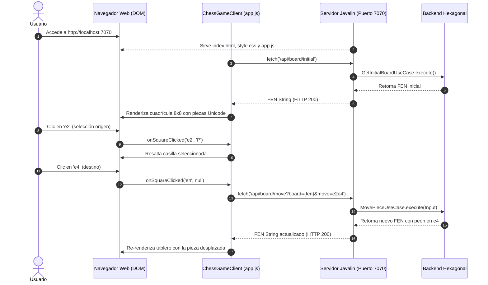

# Arquitectura del Frontend y Comunicación Web — Chess Software

Este documento describe la arquitectura técnica del cliente web ligero y su ciclo de vida con el servidor Javalin.

---

## 1. Diagrama de Secuencia: Ciclo de Vida del Frontend

---

## 2. Componentes del Cliente Web

Ubicados en `game/src/main/resources/public/`:

1. **`index.html`:**
   - Estructura semántica sin frameworks.
   - Contenedor del tablero `#board` y panel lateral `#controls` con estado y campo FEN en tiempo real.
2. **`style.css`:**
   - Grid CSS puro de $8 \times 64\text{px}$ para el tablero.
   - Colores clásicos de madera para casillas (`#f0d9b5` / `#b58863`) y resaltado de selección.
3. **`app.js` (`ChessGameClient`):**
   - **Parser FEN:** `parseFenToMatrix(fen)` convierte la notación FEN en una matriz de $8 \times 8$.
   - **Mapeador Unicode:** Traduce identificadores de pieza (`K, Q, R, B, N, P, k, q, r...`) a glifos tipográficos oficiales de ajedrez (♔, ♕, ♖, ♗, ♘, ♙...).
   - **Rutas Relativas:** Utiliza URLs relativas (`/api/board/...`) para garantizar portabilidad inmediata a cualquier dominio o entorno sin tocar código.
